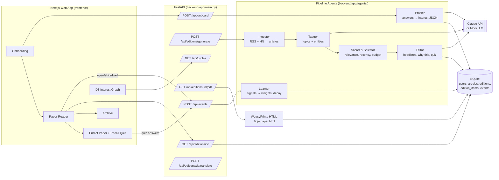

# The Fold — *a paper that ends.*

A personal morning newspaper. It learns what you care about, gathers the articles that matter from across the web,
and prints **one finite edition** — on the web and as a broadsheet-style PDF. Built for NaSCon'26 (8-hour hackathon).

## Why it's different

- **It ends.** No infinite scroll. The edition is sized to your reading budget and closes on *"That's the paper."*
- **It explains itself.** Every story has a *Why this?* tracing back to your own words and behaviour.
- **It visibly learns.** Skips, opens, reading time and a daily recall quiz reshape tomorrow's paper. See it in the interest graph.
- **Blind Spot.** One story a day from outside your bubble — and you control how much challenge you want.

## Quick start

```bash
cp .env.example .env                 # MOCK_LLM=1 works with no API key
# backend
cd backend && python -m venv .venv && source .venv/bin/activate
pip install -r requirements.txt
python -m app.seed.make_demo         # optional: personas Ayesha + Bilal
uvicorn app.main:app --reload --port 8000
# frontend (new terminal)
cd frontend && npm install && npm run dev      # http://localhost:3000
```

PDF export uses WeasyPrint. On Debian/Ubuntu: `sudo apt install libpango-1.0-0 libpangoft2-1.0-0`. Without it the app serves a print-ready HTML page instead.

Real LLM: set `ANTHROPIC_API_KEY` and `MOCK_LLM=0`. Live feeds: `LIVE_INGEST=1`.

## Tests

```bash
cd backend && pytest -q
```

## Project layout

```
CLAUDE.md            orchestrator instructions (start here if vibe-coding with agents)
.claude/agents/      8 specialist sub-agents      .claude/commands/  slash commands
docs/                PRD, architecture, tasks, API, design system, prompts, git workflow, demo script
backend/app/         FastAPI + pipeline agents (ingest, tagger, profiler, scorer, editor, learner, quiz, pdf)
backend/tests/       pytest suite
frontend/            Next.js 14 reader, onboarding, archive, interest graph
scripts/             init_repo.sh, commit.sh, dev_check.sh, smoke.sh
```

## Architecture



See [`docs/ARCHITECTURE.md`](docs/ARCHITECTURE.md) for full sequence diagrams and detailed schema.


## Building this with an AI agent team

Open the folder in Claude Code and say: **"Read CLAUDE.md and start the loop."** The orchestrator delegates to the sub-agents and commits after every task
(`scripts/commit.sh`) so the GitHub history shows steady progress.

## Features built & verified

- **Personalized Finite Editions:** Sized to 5, 12, or 20-minute morning budgets with broadsheet styling and end-of-paper completion.
- **Explainable "Why this?":** Every story explicitly cites the user's onboarding quotes or recent behavioral interactions.
- **Continuous Learning Loop:** Profile weights dynamically adapt from skips, opens, dwell times (IntersectionObserver >= 8s), and quiz responses with exponential decay.
- **Blind Spot Column:** Daily perspective from outside the user's reading bubble, complete with an interactive challenge tuner.
- **Interactive Interest Graph:** Force-directed D3 network graph with interactive nudge controls and historical sign-up comparison.
- **Urdu Headline Toggle (i18n):** Instant bilingual mode translating headlines to fluent Urdu via LLM with persistent SQLite caching.
- **Recall Quiz:** End-of-paper interactive 3-question quiz with real-time feedback and interest graph reinforcement.
- **Offline & Online Resilience:** 120 curated seed articles across 24 topics, live RSS & Hacker News ingest with deduplication, and mock/Claude LLM flexibility.

