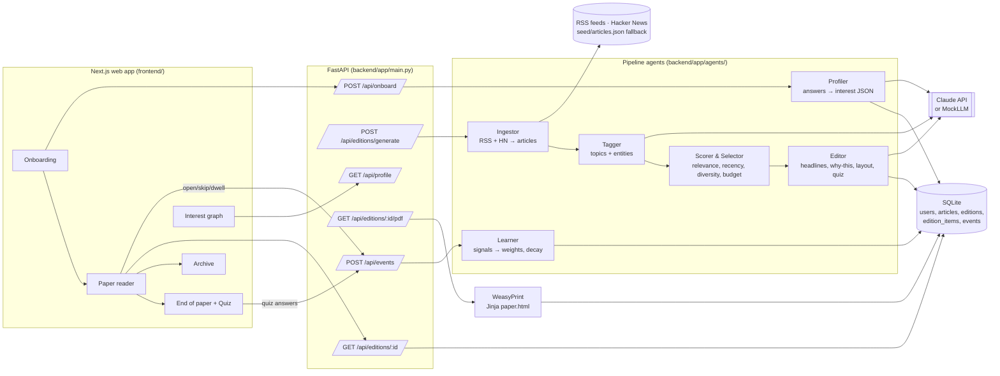

# Architecture — The Fold

## System diagram



## Edition generation sequence

```mermaid
sequenceDiagram
    participant U as Reader
    participant FE as Next.js
    participant API as FastAPI
    participant ING as Ingestor/Tagger
    participant SC as Scorer
    participant ED as Editor (LLM)
    participant DB as SQLite
    U->>FE: "Print today's edition"
    FE->>API: POST /api/editions/generate
    API->>ING: refresh pool (skip if < 2h old)
    ING->>DB: upsert tagged articles
    API->>SC: select(profile, pool, budget)
    SC-->>API: ranked picks + blind spot
    API->>ED: write(picks, profile)
    ED-->>API: headlines, summaries, why, layout, quiz
    API->>DB: save edition + items
    API-->>FE: edition JSON
    FE-->>U: render paper; PDF on demand
```

## Learning loop

```
weight[t] ← clamp( weight[t]·0.97  +  Σ signal_delta(event, t) , 0.02, 1.0 )

open        +0.12      skip          −0.18
dwell ≥ 30s +0.08      quiz_correct  +0.05
quiz_wrong  +0.02      more/less challenge → blind_spot_appetite ±0.15
```
Applied to every topic tagged on the article. New topics discovered through opens enter at 0.25.

## Data model (SQLite)

| Table | Key columns |
|---|---|
| `users` | id, name, city, budget_min, lang, profile_json, created_at |
| `articles` | id, url (unique), title, source, summary, content, topics_json, entities_json, published_at, word_count, image_url |
| `editions` | id, user_id, number, date, plan_json, editor_note, todo, quiz_json, created_at |
| `edition_items` | id, edition_id, article_id, slot, section, headline, dek, why, is_blind_spot, read_min |
| `events` | id, user_id, edition_id, article_id, type, value, created_at |
| `profile_snapshots` | id, user_id, profile_json, created_at — powers "before/after" in the graph |

## Tech choices

| Layer | Choice | Why |
|---|---|---|
| Frontend | Next.js 14 (app router) + TypeScript + CSS modules + D3 | Fast to build, sleek typography control |
| Backend | FastAPI + sqlite3 | Zero-setup, easy to test |
| LLM | Anthropic Claude (`anthropic` SDK); MockLLM fallback | Strong JSON + writing; offline demo safety |
| Similarity | Weighted keyword/topic cosine (pure Python) | No model download; swap for embeddings later |
| PDF | Jinja2 + WeasyPrint, QR via `qrcode` | Real CSS columns, print-grade typography |

> Export this diagram for submission: paste the mermaid block into https://mermaid.live → PNG → save as `docs/architecture.png`.
